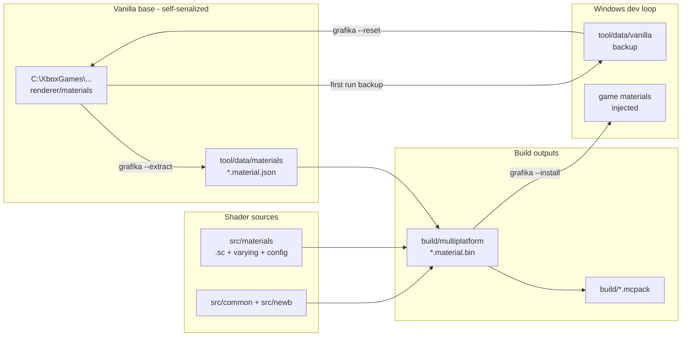

# Grafika Shader

An anime-style shader for Minecraft Bedrock (RenderDragon).

## Requirements

- [Git](https://git-scm.com/)
- Python 3.11 or higher
- Python packages (see `requirements.txt`):
  - [lazurite](https://veka0.github.io/lazurite/#installation) `==0.12.0` (Minecraft 1.26.60 / material version 26)
  - [rich](https://rich.readthedocs.io/) `==15.0.0`
  - `packaging>=25.0`, `pillow>=11.0`, `numpy>=2.0`

> [!NOTE]
> Minecraft 1.26.60 ships material version 26 in two buffer layouts (most materials carry a new 4-byte field, 9 legacy materials don't) and no single stock lazurite version reads both. `grafika --extract` retries the legacy layout on files that fail the stock read, so one lazurite install serializes the whole game dir.

### Get source code

```
git clone https://github.com/daniswastaken/grafika/
cd grafika
python -m pip install -r requirements.txt
```

### Setup build environment

> On Windows, run `.\build.bat` instead of `./build.sh` for all following commands.

```
./build.sh setup
```

This downloads the `shaderc` compiler into `tool/data/`. Material sources are **not** downloaded — generate them from your own game:

```
python grafika/grafika.py --extract
```

### Compile materials

```
./build.sh mats
```

Compiled `.material.bin` files land in `build/multiplatform/`.

**Command usage:**
```
usage: build mats [-h] [-m M [M ...]] [-s S] [--lite]

options:
  -h, --help            show this help message and exit
  -m M [M ...]          build materials (eg: Sky)
  -s S                  subpack config to use (eg: NO_WAVE)
  --lite                build with config_lite.h
```

### Build the full shader pack

```
./build.sh pack
```

The final mcpack will be inside `build/`.

**Command usage:**
```
usage: build pack [-h] [--lite] [--no-zip] [--no-label] [-v V]

options:
  -h, --help            show this help message and exit
  --lite                build with config_lite.h
  --no-zip              don't make archive
  --no-label            don't label materials
  -v V                  version number eg: 17
```

> [!TIP]
> One `multiplatform` profile compiles ESSL_300 + Direct3D_SM50 + Metal from the same sources — one bin set works on Android, Windows and iOS. Cloud subpacks (Realistic / Rounded / Box) are built automatically into `subpacks/`.

### Configuration

Pack identity and support floor live in `src/newb/pack_config.toml`:

```toml
name = "Grafika Shader"
version = [0, 2, 0]
min_supported_mc_version = [1, 26, 0]
```

Cloud subpack variants are declared in the same file. Per-profile macros and the material include list live in `src/materials/project.json`.

## Grafika dev tool (Windows only)

`grafika/` automates the Windows edit-compile-test loop: **extract → compile → inject → reset**, against the stable edition only (`C:\XboxGames\Minecraft for Windows`, no Preview). Pure stdlib, no IObit, no loaders required.

```bash
python grafika/grafika.py --extract   # serialize ALL game bins to base JSONs
python grafika/grafika.py --serialize # re-serialize base JSONs only (no backup/diff)
python grafika/grafika.py --install   # compile multiplatform mats + inject
python grafika/grafika.py --reset     # restore vanilla materials from backup
python grafika/grafika.py             # interactive TUI (same commands + status)
```

**First run:** `--extract`, then `--install`. **After a game update** (the only event that restores original files — launching never does): `--extract` again (it diffs and tells you what changed), then `--install`. **To uninstall:** `--reset`.

Why it's safe:

- `--extract` **refuses** an injected game folder instead of baking your own output back into the base
- First run snapshots all vanilla bins (`tool/data/vanilla/`) with SHA-256 hashes; every injection is hash-verified with automatic rollback on mismatch
- `--reset` restores exactly the set `--install` recorded — no more, no less
- All state under gitignored `tool/data/`; nothing machine-specific is ever committed

Runs in your current terminal (Warp/bash/cmd, `--plain` forces line mode for dumb terminals). Writes usually succeed unelevated; `--elevate` (or an elevated terminal) covers the rest — via [gsudo](https://github.com/gerardog/gsudo) in-window when installed, UAC popup otherwise.

```
grafika/
  grafika.py  # thin CLI entry (flags headless, no args = TUI)
  core.py     # extract / compile / inject / reset logic
  ui.py       # terminal UI (chatbox + plain fallback)
  app.py      # TUI main loop
  commands/   # extract.py install.py reset.py status.py pack.py alpha.py
```

## Updating for New Minecraft Versions

When a new Minecraft update changes the material structure:

1. Check the new material `version` against your `lazurite` first — each lazurite caps at a max version. Going past it gives `Unsupported material version` and no usable bins.
2. Run `python grafika/grafika.py --extract` against the updated game. It serializes the new game bins into `tool/data/materials` (legacy-layout files fall back automatically — see `grafika/laz_compat.py`), diffs the change set for you, and refreshes the vanilla backup.
3. Rebuild as usual.

## Architecture



## Development

Clangd gives code completion and error checks for sources under `src/newb` (fake bgfx header + clangd config shipped):

- **Neovim**: install clangd LSP
- **VSCode**: install [vscode-clangd](https://marketplace.visualstudio.com/items?itemName=llvm-vs-code-extensions.vscode-clangd)

## Tool documentation

See [tool/TOOL.md](tool/TOOL.md) for internals of the build tool.

## Credits & License

- **Base Shader**: [Newb Shaders](https://github.com/devendrn/newb-shader-mcbe) by devendrn.
- **Modifications & tooling**: daniswastaken.
- **License**: The source code is licensed under the **MIT License**. Compiled packs: see `pack_config.toml` copyright.
